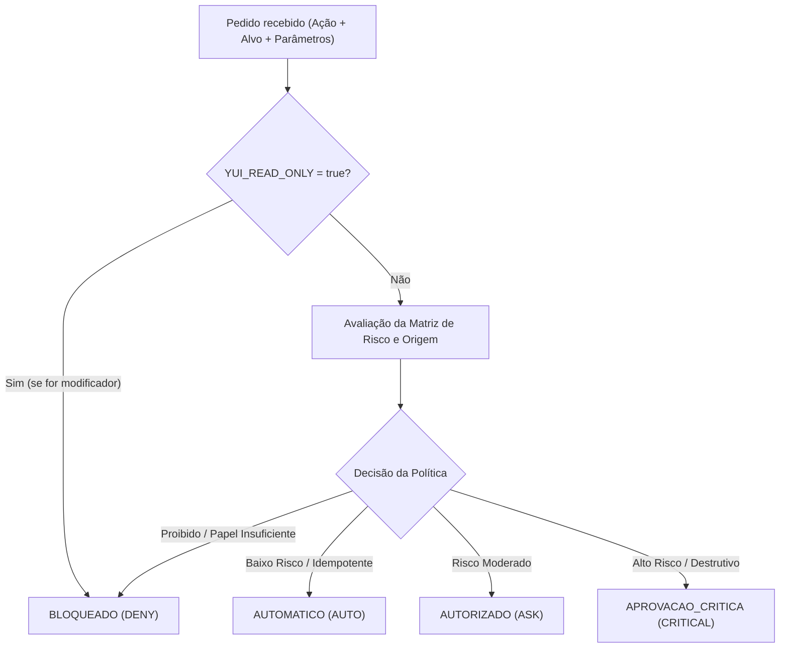
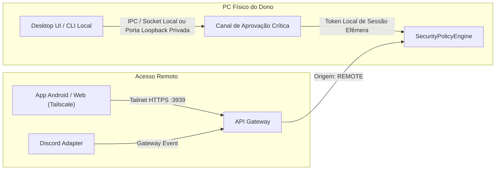
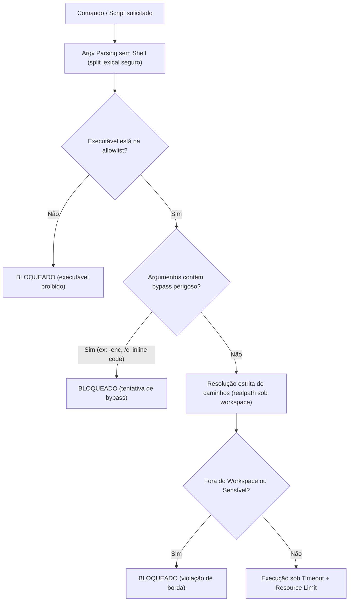

# Especificação Técnica Aprofundada: Motor Unificado de Políticas e Permissões (Fase 1 - R01/R02/R03/R12)

Esta especificação técnica estabelece a arquitetura detalhada, modelo formal de dados, garantias criptográficas, matriz de decisão e plano de testes para o **SecurityPolicyEngine** da Yui, em conformidade com as recomendações R01, R02, R03 e R12 da Auditoria Técnica e as diretrizes do Braga AI Hub.

> [!IMPORTANT]
> **Documento de Especificação Arquitetural e Requisitos de Segurança:**
> Nenhuma implementação de código, modificação de dados de runtime ou alteração de permissões operacionais é realizada nesta tarefa.

---

## 1. Matriz de Permissões e Separação de Autoridade

O motor unificado de políticas estabelece uma separação estrita entre:
1. **Identidade do Solicitante:** Quem está emitindo o comando (verificado por credencial/origem).
2. **Permissão para Solicitar (Eligibility):** Se aquele papel/origem tem permissão para submeter a intenção à avaliação.
3. **Nível de Autorização Exigido para Executar (Enactment Level):** O grau de validação e aprovação que o sistema exige antes de concretizar a ação no ambiente.

### 1.1 Os Quatro Estados de Decisão



| Estado | Código | Descrição Operacional | Requisito de Execução |
| :--- | :--- | :--- | :--- |
| **AUTOMATICO** | `AUTO` | Ação segura, de consulta ou rotina idempotente. | Executa imediatamente; gera evento de auditoria simplificado. |
| **AUTORIZADO** | `ASK` | Ação com efeito colateral moderado (postar mensagem, rádio, download). | Requer aprovação simples do dono em qualquer canal autenticado (expira em 2 min). |
| **APROVACAO_CRITICA** | `CRITICAL` | Ação com alto risco de segurança ou impacto estrutural (executar terminal, editar código, apagar toda a memória, banir usuário). | Requer aprovação estrita no **PC físico local** (canal loopback autenticado; expira em 60s). |
| **BLOQUEADO** | `DENY` | Ação proibida por política fixa, restrição de papel, canal inseguro ou modo somente leitura. | Recusa imediata com justificativa explícita e alerta/auditoria. |

### 1.2 Matriz Canônica Ação × Papel × Origem

| Categoria | Ação Canônica | OWNER (PC Físico Local) | OWNER (Remoto / Tailnet) | OWNER (Discord DM) | ADMIN_GUILD (Discord) | TRUSTED / MEMBER |
| :--- | :--- | :--- | :--- | :--- | :--- | :--- |
| **Memória** | `memory.read_own` | `AUTO` | `AUTO` | `AUTO` | `AUTO` | `AUTO` *(somente contagem em canal público)* |
| **Memória** | `memory.forget_item` | `AUTO` | `AUTO` | `AUTO` | `AUTO` | `AUTO` |
| **Memória** | `memory.wipe_own` | `ASK` *(confirmação 2FA texto)* | `ASK` | `ASK` | `ASK` | `ASK` *(confirmação "sim, apagar tudo")* |
| **Memória** | `memory.admin_inspect` | `AUTO` | `AUTO` | `AUTO` | `DENY` | `DENY` |
| **Memória** | `memory.admin_wipe_user`| `CRITICAL` | `DENY` | `DENY` | `DENY` | `DENY` |
| **Conversa**| `chat.generate_image` | `AUTO` | `AUTO` | `AUTO` | `AUTO` *(sob cota 6/h)* | `AUTO` *(sob cota 6/h + NSFW filter)* |
| **Conversa**| `chat.summarize` | `AUTO` | `AUTO` | `AUTO` | `AUTO` *(sob cota 1/min)*| `AUTO` *(sob cota 1/min + blindagem)* |
| **Mídia** | `radio.play_control` | `AUTO` | `AUTO` | `AUTO` | `AUTO` *(se conectado)* | `AUTO` *(se conectado)* |
| **Mídia** | `radio.download_track` | `AUTO` | `AUTO` | `AUTO` | `AUTO` | `DENY` |
| **Servidor**| `admin.guild_configure`| `AUTO` | `AUTO` | `AUTO` | `AUTO` *(ManageGuild)* | `DENY` |
| **Servidor**| `admin.follow_social` | `AUTO` | `AUTO` | `AUTO` | `ASK` *(confirmação)* | `DENY` |
| **Servidor**| `admin.ban_user` | `AUTO` | `AUTO` | `CRITICAL` | `DENY` | `DENY` |
| **Código** | `dev.read_file_search` | `AUTO` | `AUTO` | `AUTO` | `DENY` | `DENY` |
| **Código** | `dev.write_apply_diff` | `CRITICAL` | `DENY` | `DENY` | `DENY` | `DENY` |
| **Código** | `dev.run_terminal` | `CRITICAL` | `DENY` | `DENY` | `DENY` | `DENY` |

---

## 2. Identidade e Prova de Origem Confiável (Anti-Spoofing)

### 2.1 Fragilidade do Modelo Legado (R02)
Anteriormente, o sistema utilizava a função `isLocalRequest()`, que verificava apenas se o IP remoto era `127.0.0.1` e se cabeçalhos como `x-forwarded-for` estavam ausentes.
*Vulnerabilidade:* Um proxy local, túnel SSH reverso mal configurado ou aplicação intermediária rodando no loopback sem encaminhar cabeçalhos permitia que um cliente remoto simulasse ser "local", podendo aprovar ou gravar código.

### 2.2 Arquitetura de Prova de Origem Segura
A classificação da origem deixa de depender de cabeçalhos HTTP e passa a operar por **canais fisicamente e criptograficamente segregados**:



1. **Canal de Aprovação Crítica Segregado:**
   - As aprovações de nível `CRITICAL` **não passam pelo endpoint HTTP principal da API** (`:3939`).
   - É estabelecido um canal exclusivo no PC: **Named Pipe (Windows IPC)** ou **Porta Loopback Dedicada (ex: `127.0.0.1:3940`)** restrita exclusivamente a processos do mesmo usuário do Windows (`LocalSystem` / `mauri`), protegida por um segredo efêmero (`local_nonce`) gerado na subida da aplicação e gravado com permissão restrita `0600` em memória/arquivo protegido fora do repositório.
2. **Classificação Confiável de Contexto:**
   - `ORIGIN_LOCAL_PC`: Autenticado exclusivamente via canal IPC/Loopback autenticado.
   - `ORIGIN_TAILNET`: Conexões via Tailscale Serve identificadas pelo cabeçalho interno da Tailnet e autenticação de token do dono.
   - `ORIGIN_DISCORD_DM`: Mensagens privadas verificadas pelo Snowflake do dono (`ownerUserId`).
   - `ORIGIN_DISCORD_GUILD`: Mensagens públicas do Discord; `ADMIN_GUILD` validado pelas permissões nativas `ManageGuild` da API do Discord.

---

## 3. Modelo Formal de Aprovação (`ApprovalPlan`) e Ciclo de Vida

Todo pedido que requer intervenção humana (`ASK` ou `CRITICAL`) gera um `ApprovalPlan` imutável.

### 3.1 Estrutura Canônica do Ticket

```typescript
interface ApprovalPlan {
  // Identificação e Rastreabilidade
  id: string;                      // UUID v4 único do ticket
  policyVersion: string;           // ex: "1.0.0" (versão das regras ativas)
  createdAt: number;               // Timestamp Unix (ms)
  expiresAt: number;               // Timestamp Unix (ms) de expiração
  
  // Solicitante
  requesterId: string;             // ID do usuário solicitante
  requesterRole: Role;             // OWNER, ADMIN_GUILD, etc.
  requesterOrigin: OriginKind;     // ORIGIN_LOCAL_PC, ORIGIN_TAILNET, etc.
  sessionId: string | null;        // ID da sessão ou execução (ex: runId do dev)

  // Ação e Alvo Canônico
  action: string;                  // ex: "dev.run_terminal", "dev.write_file"
  canonicalTarget: string;         // Caminho normalizado (realpath) ou ID absoluto
  params: Record<string, unknown>; // Argumentos saneados da ação
  paramsHash: string;              // SHA-256 canônico dos parâmetros ordenados

  // Requisitos de Aprovação
  levelRequired: 'ASK' | 'CRITICAL';
  allowedApprovalOrigin: 'LOCAL_ONLY' | 'ANY_OWNER_CHANNEL';
  summary: string;                 // Resumo legível para exibição ao usuário

  // Estado e Consumo Atômico
  status: 'PENDING' | 'APPROVED' | 'REJECTED' | 'EXPIRED' | 'CONSUMED';
  approvedAt: number | null;
  approverId: string | null;
  approverOrigin: OriginKind | null;
  consumptionNonce: string | null; // UUID gerado e consumido uma única vez na execução
}
```

### 3.2 Ciclo de Vida e Consumo Atômico
- **Prazos Estritos:** `CRITICAL` expira em 60 segundos; `ASK` expira em 120 segundos.
- **Uso Único (Single-Use):** A aprovação autoriza **uma única execução**. O motor invalida o ticket (`status = CONSUMED`) no mesmo tick em que a execução é disparada.
- **Validação Dupla de Integridade:** No exato momento da execução, o motor recalcula `paramsHash` a partir dos dados recebidos para despacho. Se houver qualquer divergência de caractere, caminho ou variável, o ticket é sumariamente cancelado.

---

## 4. Integridade Criptográfica dos Tickets

Para evitar adulteração em memória, repetição de solicitações (replay attacks) ou injeção de parâmetros:
1. **Hash Canônico Determinístico (`paramsHash`):**
   - As chaves do objeto de parâmetros são ordenadas alfabeticamente de forma recursiva antes da serialização JSON.
   - O payload canônico é submetido a `SHA-256`.
2. **HMAC de Autenticidade Interna:**
   - O objeto de ticket recebe uma assinatura HMAC (`HMAC-SHA256`) gerada com uma chave de runtime mantida na memória do processo (`runtimePolicyKey`).
   - Nenhum componente externo (nem mesmo o app local ou UI) consegue forjar um ticket válido ou alterar seu status de `PENDING` para `APPROVED` sem a chave interna do motor.
3. **Prevenção de Replay:**
   - Tickets expirados, rejeitados ou já consumidos são preservados em um cache LRU de verificação por 1 hora. Qualquer tentativa de reenvio do mesmo `id` resulta em rejeição imediata com registro de tentativa suspeita.

---

## 5. Executor Seguro (`terminalSanitizer` e Isolamento de Ferramentas)

A recomendação R03 aponta expressamente: **`shell:false` não é suficiente por si só.**



### 5.1 Requisitos de Validação do `terminalSanitizer`:
1. **Execução sem Shell:** O processo é instanciado via `child_process.spawn(executable, argv, { shell: false })`.
2. **Allowlist Estrita de Binários:** Apenas comandos conhecidos e necessários são permitidos (ex: `git`, `npm`, `node`, `pytest`, `cargo`). Interpretadores com comandos arbitrários em linha (`python -c`, `node -e`, `powershell -enc`, `cmd /c`) são sumariamente bloqueados ou exigem ticket `CRITICAL` prévio específico.
3. **Isolamento de Diretório (Workspace Boundary):**
   - O `cwd` é validado e resolvido via `fs.realpathSync`.
   - Argumentos que apontem para caminhos fora da raiz do projeto ou tentem travessia (`../`, links simbólicos externos, junções NTFS) são recusados.
   - Arquivos sensíveis do ecossistema (`.env`, `*.pem`, `secrets/*`, `database/*.db`) são bloqueados contra leitura e escrita direta pelo executor de ferramentas.
4. **Limpeza e Redução de Ambiente (Env Sanitization):**
   - O processo filho **não herda** o `process.env` completo da Yui.
   - Variáveis contendo tokens (`DISCORD_TOKEN`, `API_KEY`, senhas de banco) são removidas da tabela de ambiente entregue ao processo.
5. **Limites de Recursos e Encerramento Controlado:**
   - Timeout rígido configurável (padrão: 30s para ferramentas interativas, 120s para compilações/testes).
   - Gerenciamento de processos filhos via `tree-kill` restrito exclusivamente à árvore descendente daquele PID específico, sem jamais escanear ou encerrar PIDs de terceiros no sistema.

---

## 6. Autonomia Configurável e Hierarquia de Precedência

A autonomia do sistema é customizável pelo proprietário em quatro níveis lógicos de precedência:

```
[NÍVEL 0: PISO ABSOLUTO] Modo Somente Leitura (YUI_READ_ONLY=true)
     ▼ (se desligado, avalia)
[NÍVEL 1: POLÍTICA GLOBAL DO SISTEMA] (Configuração central no .env / policy.json)
     ▼ (se permitido, avalia)
[NÍVEL 2: POLÍTICA DA CATEGORIA] (Código/Dev, Memória, Servidores, Rádio)
     ▼ (se permitido, avalia)
[NÍVEL 3: RESTRIÇÃO DA ORIGEM] (Local PC vs Tailnet vs Discord)
```

### Regras de Precedência Invioláveis:
1. **O Modo Somente Leitura vence sempre:** Se `YUI_READ_ONLY=true`, qualquer ação modificadora (gravar arquivo, rodar terminal, banir, apagar memória) é rebaixada imediatamente para `BLOQUEADO`.
2. **Escalar restrição é livre; afrouxar restrição é proibido:** Uma categoria pode exigir aprovação mais rígida do que a global, mas nenhuma configuração de categoria ou interface remota pode transformar uma ação classificada como `CRITICAL` em `AUTO`.
3. **Configuração de Autonomia por Categoria:**
   - O proprietário pode configurar categorias de ação no `.env` (ex: `POLICY_MEDIA_AUTONOMY=AUTO`, `POLICY_DEV_AUTONOMY=CRITICAL`, `POLICY_ADMIN_AUTONOMY=ASK`).

---

## 7. Eventos de Auditoria Encadeada (R04)

Cada etapa do ciclo de verificação é registrada no arquivo append-only `logs/core-audit.jsonl` com hash SHA-256 encadeado (`seq`, `prev_hash`, `hash`), sem nunca expor tokens ou dados privados:

| Evento de Auditoria | Quando é emitido | Metadados Registrados |
| :--- | :--- | :--- |
| `policy.evaluate` | Ao avaliar qualquer ação | `action`, `decision` (`AUTO/ASK/CRITICAL/DENY`), `role`, `origin`, `targetHash` |
| `policy.approval_created` | Ao gerar ticket `ApprovalPlan` | `approvalId`, `action`, `paramsHash`, `expiresAt`, `levelRequired` |
| `policy.approved` | Quando o aprovador autoriza | `approvalId`, `approverId`, `approverRole`, `approverOrigin`, `action` |
| `policy.rejected` | Quando a ação é recusada | `approvalId`, `approverId`, `reason` |
| `policy.expired` | Quando o prazo limite vence | `approvalId`, `action`, `timeoutMs` |
| `policy.enacted` | No momento da execução segura | `approvalId`, `action`, `executionTimeMs`, `exitCode` |
| `policy.violation` | Tentativa de bypass ou spoofing | `action`, `attemptedOrigin`, `violationType`, `target` |

---

## 8. Integração Arquitetural com os Módulos Existentes

```
                       ┌────────────────────────┐
                       │   INTERFACES DA YUI    │
                       │ (Discord, API, App Dev)│
                       └───────────┬────────────┘
                                   │
                                   ▼
                       ┌────────────────────────┐
                       │ buildSecurityContext() │  (Resolução de Papel e Origem)
                       └───────────┬────────────┘
                                   │
                                   ▼
                       ┌────────────────────────┐
                       │  SecurityPolicyEngine  │  (Ponto Central Único)
                       │   checkAction(ctx)     │
                       └─────┬───────────┬──────┘
                             │           │
              ┌──────────────┘           └──────────────┐
              ▼                                         ▼
   ┌───────────────────────┐                 ┌───────────────────────┐
   │    ApprovalManager    │                 │   TerminalSanitizer   │
   │ (Tickets + Integridade│                 │ (Spawn seguro sem     │
   │  e Consumo Atômico)   │                 │  shell + Allowlist)   │
   └──────────┬────────────┘                 └──────────┬────────────┘
              │                                         │
              └───────────────────┬─────────────────────┘
                                  ▼
                       ┌────────────────────────┐
                       │  logs/core-audit.jsonl │  (Hash Encadeado R04)
                       └────────────────────────┘
```

1. **`src/core/permissions.js`**:
   - Mantém as definições de papéis (`OWNER`, `MEMBER`, etc.) e passa a exportar as constantes de estado do motor de políticas (`POLICY_STATES: { AUTO, ASK, CRITICAL, DENY }`).
2. **`src/core/audit.js`**:
   - Recebe as chamadas formais de auditoria de cada avaliação e ticket gerado pelo motor.
3. **`src/core/dev/`**:
   - As funções `agent.js` e `index.js` deixam de usar a política isolada local e passam a delegar a verificação de comandos e arquivos ao `SecurityPolicyEngine`.
4. **Rotas de Conversação (`chatIntents.js` / `llmHandler.js`):**
   - As Portas I, N, R, G e M consultam o motor para validar se o contexto da conversa atende aos requisitos daquela ação antes do despacho.

---

## 9. Plano de Testes de Aceitação e Segurança

A suíte de testes unitários e de integração (`tests/test-security-policy.js`) deverá cobrir rigorosamente os seguintes cenários:

1. **Tentativa de Aprovação Crítica Remota:**
   - Provar que requisições originadas com `ORIGIN_TAILNET` ou `ORIGIN_DISCORD` recebem `DENY` imediato ao tentar aprovar ações `CRITICAL`.
2. **Anti-Spoofing de Origem Local:**
   - Simular cliente remoto injetando cabeçalhos de loopback ou conexões de proxy sem cabeçalhos; provar que a falta do segredo/canal IPC local impede a concessão de privilégio local.
3. **Adulteração de Parâmetros (Tampering):**
   - Criar um ticket de aprovação para `git status`, aprovar o ticket, e tentar executá-lo passando `git push --force`. O motor deve detectar a divergência de `paramsHash` e abortar.
4. **Replay de Ticket:**
   - Tentar reutilizar um ticket já consumido ou expirado; provar que o ticket é recusado.
5. **Concorrência e Race Conditions:**
   - Disparar múltiplas requisições simultâneas tentando consumir o mesmo ticket de aprovação; provar que exatamente uma executa e as demais falham (consumo atômico).
6. **Tentativas de Evasão de Terminal (R03 Bypass Test):**
   - Testar payloads: `cmd.exe /c calc`, `powershell -enc ...`, `python -c ...`, `node -e ...`, `foo && bar`, `foo | bar`. Provar que nenhum payload executa sem estar expressamente na allowlist de binários seguros e sem ticket de aprovação.
7. **Borda do Workspace:**
   - Provar que comandos ou gravações tentando acessar `../../` ou arquivos sensíveis como `.env` e `database/core.db` são interceptados e bloqueados.
8. **Modo Somente Leitura:**
   - Provar que com `YUI_READ_ONLY=true`, 100% das ações de escrita e execução de terminal recebem `DENY`.

---

## 10. Compatibilidade com Recursos Existentes (Portas I, N, R, G, M)

As funcionalidades de conversa integradas recentemente operam com impacto zero na experiência do usuário comum:
- **Porta I (Imagem):** Avaliada como `AUTO` para todos os usuários autorizados (respeitando o rate limit de 6/hora e o filtro NSFW já integrados).
- **Porta N (Memória):** Consultas e exclusões pontuais da própria memória são avaliadas como `AUTO`. A exclusão completa (`apagar tudo`) permanece classificada como `ASK`, exigindo a confirmação textual "sim, apagar tudo" em 2 minutos.
- **Porta R (Resumo):** Avaliada como `AUTO` (respeitando a cota de 1/min por pessoa e o isolamento de mensagens de terceiros como dados).
- **Porta G (GTA) e Porta M (Rádio):** Consultas de GTA e comandos normais de player de rádio no servidor são avaliados como `AUTO`. Comandos com potencial disruptivo (ex: desconectar o bot do canal de voz por usuário comum sem permissão de voz) são classificados como `DENY` ou restritos a administradores.

---

## 11. Ordem Recomendada de Implementação e Decisões do Dono

### 11.1 Dependências e Ordem de Implementação Técnica
1. **Passo 1:** Criação de `src/core/security/permissionMatrix.js` e `src/core/security/policyEngine.js` (estruturas e avaliações em memória com testes unitários).
2. **Passo 2:** Implementação do canal seguro de aprovação local (R02 - IPC/Loopback autenticado).
3. **Passo 3:** Implementação de `src/core/security/terminalSanitizer.js` (R03 - spawn seguro sem shell com allowlist).
4. **Passo 4:** Migração do módulo Código (`src/core/dev/`) e das ferramentas do agente para o novo motor.

### 11.2 Decisões Reservadas ao Proprietário:
- [ ] Aprovar a lista inicial de executáveis permitidos no `terminalSanitizer` (ex: `git`, `npm`, `node`, `pytest`).
- [ ] Definir se a aprovação local no PC físico será feita inicialmente via CLI interativa/terminal local ou através de janela nativa do Desktop (R13).
- [ ] Validar os tempos de expiração dos tickets (60s para ações críticas e 120s para autorizações simples).
